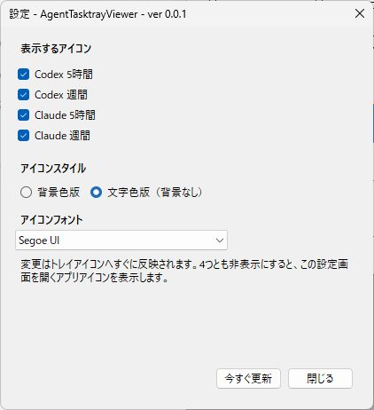
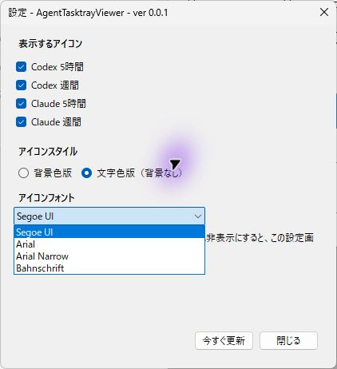
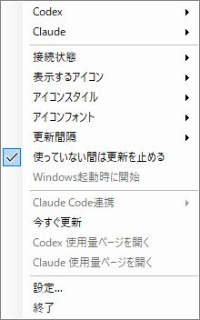
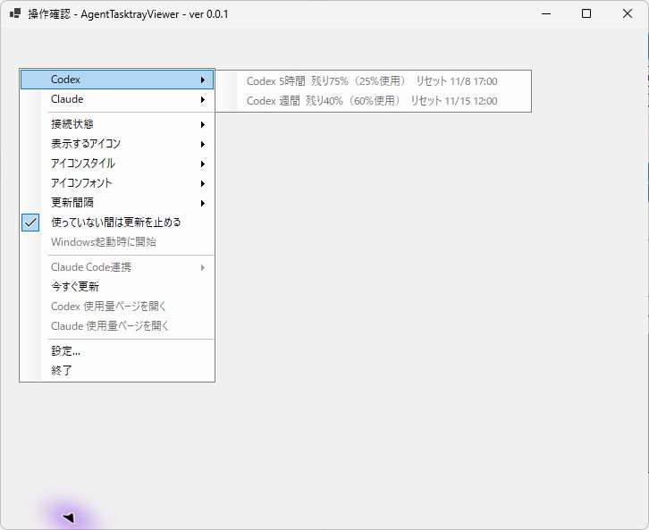
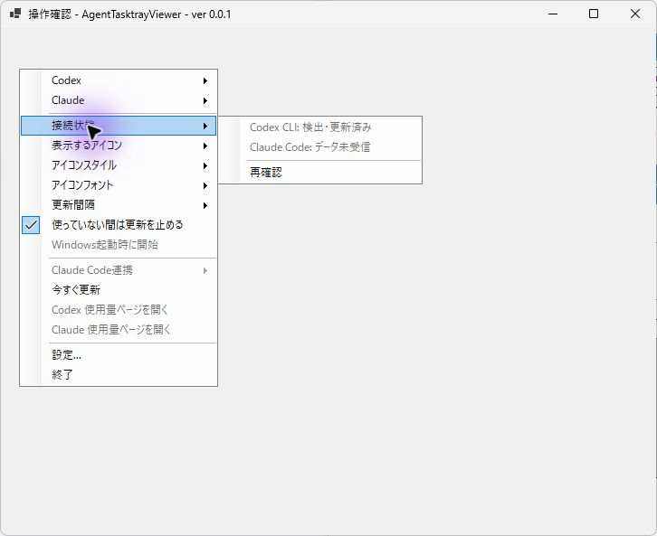

# AgentTasktrayViewer

CodexとClaude Codeの使用量を、Windowsの通知領域（タスクトレイ）で確認する常駐アプリです。5時間枠と週間枠を別々のアイコンで表示します。

Windows 10/11 x64向けです。このリポジトリでは操作ガイドを公開しています。インストール済みのアプリの起動方法は[利用者ガイド](docs/USERS_GUIDE.md)を確認してください。自動起動は初期状態ではOFFです。

## 画面で見る使い方

画像は0.0.1の操作例です。設定は専用の撮影用データ、残量と接続状態は架空の値です。メニューは実際の製品と同じものを専用窓に表示しています。撮影中はWindows起動時の登録・Claude連携・外部ページを開く操作を無効にしています。

### 1. 表示する枠を選ぶ

起動時の設定画面、またはトレイを右クリックして「設定...」を開きます。CodexとClaudeの5時間・週間枠から表示したいものを選んでください。4つともOFFにすると設定を開くアイコンだけになります。

### 2. 読みやすい文字にする

アイコンスタイルとフォントを選ぶと、表示へすぐ反映されます。タスクバーの背景に合わせて「背景色版」と「文字色版」を選べます。

### 3. トレイから操作する

アイコンを右クリックするとメニューが開きます。「今すぐ更新」で取得をやり直し、「更新間隔」で定期更新の頻度を選びます。終了すると表示も止まります。

### 4. 残量とリセット時刻を見る

「Codex」または「Claude」を開くと、残りの割合・使用割合・リセット時刻を確認できます。画像の75%は残量で、使用済みは25%です。取得前や取得できない状態は「?」になります。

### 5. 取得できない理由を調べる

「接続状態」を開きます。CLI未検出、取得失敗、Claudeの連携未設定・データ未受信などを区別できます。必要なCLIの導入・ログイン・連携を確認してから再確認してください。

## 保存・自動起動・終了

表示設定は変更した時点で保存されます。Windowsへのサインイン時に起動する場合は「Windows起動時に開始」を選びます。KotorinToys経由の自動起動とは二重に設定しないでください。トレイの「終了」で終了します。

## プライバシー

CodexおよびClaudeの認証情報を直接読み取りません。使用量取得を目的としたAIへのプロンプト送信も行いません。

- [利用者ガイド](docs/USERS_GUIDE.md)
- [FAQ](docs/FAQ.md)
- [ライセンス](LICENSE)
